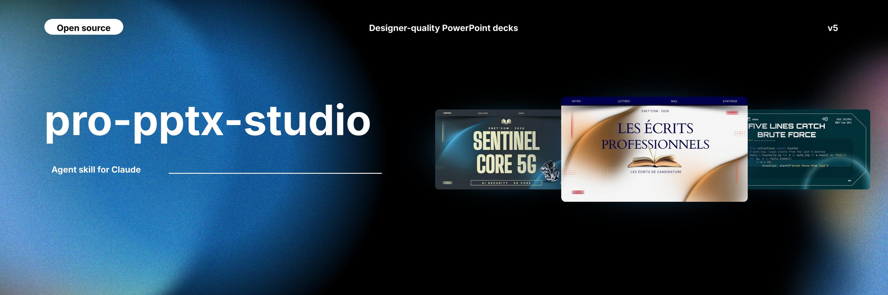
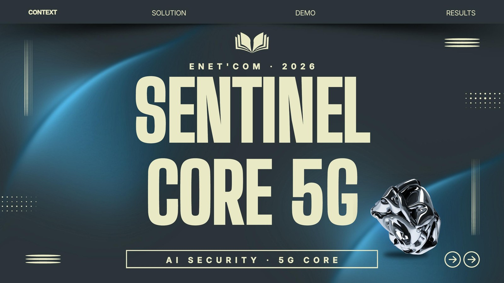

<p align="center"></p>

# pro-pptx-studio

An agent skill for Claude that builds PowerPoint (.pptx) decks that look designer-made. Instead of drawing slides from code, it builds on **your own templates** (Canva exports, SlidesCarnival decks and similar) and keeps their backgrounds, photos and fonts. It then fits your content, adds charts, KPI tiles, code windows, diagrams, logos, Morph transitions and slide numbers, and checks the result visually before delivering it.

Current version: **v5** (October 2026).

## Example

A cover built by the skill: a thesis-defense template recolored to cyan, with a chrome object cut out from another template and placed in front of the title.

<p align="center"></p>

## Features

- **Template library** (`scripts/library.py`): indexes a folder of .pptx templates. Every slide is rendered, its role is detected (cover, plan, stats, timeline, chart…), text slots are measured, and topics are tagged. New files are picked up automatically by content hash.
- **Cover preview** (`scripts/tplpreview.py`): shows your title on the covers of the best-matching templates, so you choose before anything is built.
- **Builder** (`scripts/tplbuild.py`):
  - fills template slides with fitted text and swaps pictures;
  - mixes slides from different templates, harmonized to one hue, and recolors them to the topic;
  - switches to fonts that suit the topic;
  - adds charts, KPI tiles, tables, code windows, timelines and device mockups;
  - adds Morph transitions, step reveals and speaker notes, and embeds the fonts.
- **Polish pass** (`scripts/tplpolish.py`):
  - logos on light chips;
  - text centered in its containers;
  - numbered hexagon plan cards;
  - editable architecture diagrams (tiles with icons cropped from a screenshot, panels, links);
  - charts with gradients and a glow on the key value;
  - uniform KPI tiles;
  - **automatic slide numbers**: the cover is blank, the table of contents is 1, and the closing slide is numbered.
- **House rules** in `SKILL.md`:
  - titles on top;
  - bullets, not paragraphs;
  - no text over the central art;
  - calm backgrounds on text-heavy slides;
  - every fact verified against the user's primary files.
- **Visual QA** (`scripts/render.py`): renders the deck with the template's own fonts so problems can be spotted.
- **Fallback generator** with 59 styles (`scripts/deckkit.js`), and **banners** in 25 sizes (`scripts/banner.js`).

## Requirements

- Python 3.10+ with the packages in `requirements.txt`.
- LibreOffice and Poppler, for previews and QA renders.
- Node.js 18+, only for the fallback generator and banners (`npm install`).

## Install

**claude.ai (web, desktop app)**
1. Download `pro-pptx-studio-v5.zip` from the [Releases](../../releases) page.
2. In Settings → Capabilities, enable code execution.
3. In Customize → Skills, upload the zip.
4. Use the skill in a chat linked to the computer that holds your templates.

**Claude Code**
```bash
git clone https://github.com/Idriss-Mokdadi/pro-pptx-studio.git ~/.claude/skills/pro-pptx-studio
cd ~/.claude/skills/pro-pptx-studio
pip install -r requirements.txt
npm install                     # only for the generator and banners
```

## Your template library

Templates are **not** included in this repository, because each user brings their own. Keep them in one folder:

```
<your folder>/
├── Templates/          # your .pptx templates: add new ones here any time
└── template-library/   # generated index (do not edit by hand)
```

Point the skill at it with `export PPS_LIB=/path/to/template-library`, or edit the path in section 3 of `SKILL.md` (it currently points to the author's `E:\claude-skills\pro-pptx-studio-skill`). The first time you ask for a deck, every template is indexed; after that, only new files are.

## Usage

Ask Claude naturally, for example:

- "Make a 10-minute English defense presentation from my internship report."
- "Make a pitch deck for my IoT project, dark and futuristic."
- "Make a webinar banner for our IEEE event."

The skill previews covers, builds the deck, polishes it, renders it for QA and delivers the .pptx.

## Repository layout

```
SKILL.md            instructions Claude follows (house rules, pipeline)
references/         detailed guides (template mode, storytelling, taste, styles, banners)
scripts/            Python and Node tools (library, build, polish, render, generator)
assets/             fonts, 3D objects and styles, packed in bundle.tar.xz (unpacked on first use)
examples/           example specs and placeholder images
docs/               banner and example image for this README (the banner itself was built with the skill)
```

## Licenses

The banner was built with the skill on a SlidesCarnival template (CC BY 4.0, slidescarnival.com).


- **Code:** MIT (see `LICENSE`).
- **Fonts:** SIL Open Font License 1.1.
- **3D objects:** Microsoft Fluent Emoji, MIT.
- **Icons:** react-icons (MIT; Lucide is ISC, Phosphor is MIT).

Details are in `THIRD_PARTY.md`. Templates you use keep their own licenses. Canva templates are for their owner's use only and must not be published. SlidesCarnival templates are CC BY 4.0, and decks built on them get a credit line automatically.

## Changelog

- **v5** (October 2026): automatic slide numbering starting at the table of contents (`polish.numbers`, on by default, moves above logo chips); library kept in one folder; banners are always wide (`polish.canvas` crops a template slide to 3:1 or 2:1); reuses a template's own page numbers (restyled to start at the table of contents) instead of adding a second set.
- **v4** (October 2026): house rules from the internship-defense feedback, a default jury-defense outline, the polish pass, fact-checking of AI-made summaries, and a speech plus jury Q&A at delivery.
- **v3**: template mode, cover preview, slide mixing, depth covers.
- **v2**: generator with 59 styles, banners.
