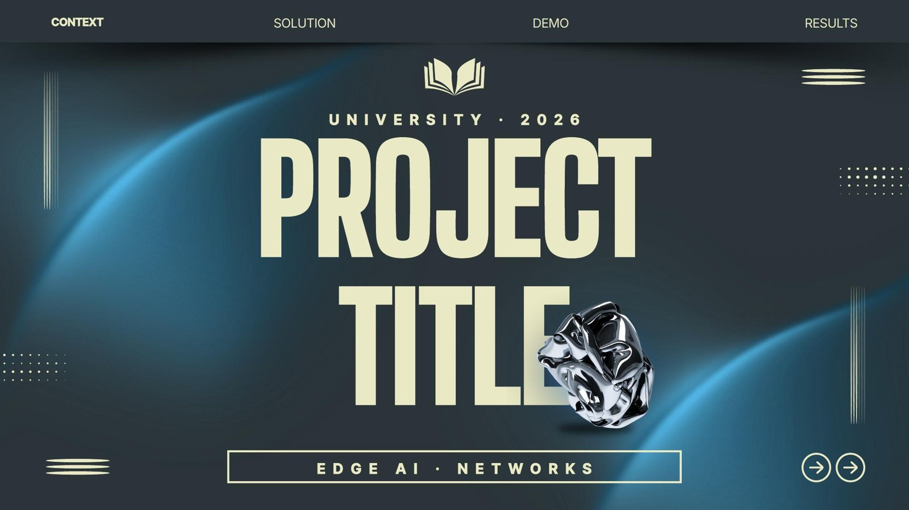

<p align="center"></p>

# pro-pptx-studio

An agent skill for Claude that builds PowerPoint (.pptx) decks that look designer-made. Instead of drawing slides from code, it builds on **your own templates** (Canva exports, SlidesCarnival decks and similar) and keeps their backgrounds, photos and fonts. It then fits your content, adds charts, KPI tiles, code windows, diagrams, logos, Morph transitions and slide numbers, and checks the result visually before delivering it.

Current version: **v6** (October 2026). See [CHANGELOG.md](CHANGELOG.md).

## Example

A cover built by the skill: a thesis-defense template recolored to cyan, with a chrome object cut out from another template and placed in front of the title.

<p align="center"></p>

## Features

- **Template library** (`scripts/library.py`): indexes a folder of .pptx templates. Every slide is rendered, its role is detected (cover, plan, stats, timeline, chart…), text slots are measured, and topics are tagged. New files are found by name (`status`) and indexed by content hash, in place on your computer (`--index-only`) or in the cloud.
- **Template preview** (`scripts/tplpreview.py`): shows your title on the covers of the best-matching templates, each next to the template's plan slide and best content slide, so you choose knowing the whole design.
- **Builder** (`scripts/tplbuild.py`):
  - fills template slides with fitted text and swaps pictures;
  - mixes slides from different templates, harmonized to one hue, and recolors them to the topic;
  - switches to fonts that suit the topic;
  - adds charts, KPI tiles, tables, code windows (any language, colored by Pygments, or a terminal with `$` prompts), timelines, device mockups and QR codes;
  - keeps word groups such as "Sprint 1" or "5 GHz" on one line, and applies French spacing for French decks;
  - adds Morph transitions, step reveals and speaker notes, and embeds the fonts.
- **Polish pass** (`scripts/tplpolish.py`):
  - logos on light chips, text centered in its containers, numbered hexagon plan cards;
  - editable architecture diagrams (tiles with icons cropped from a screenshot, panels, links);
  - charts with gradients and a glow on the key value; uniform KPI tiles;
  - **automatic slide numbers**: the cover is blank, the plan is 1, the closing slide is numbered, backup slides are A1, A2…;
  - **Morph names** on the title, slide number and logos, so they glide from slide to slide.
- **Rule checker** (`scripts/tplcheck.py`): lists every broken house rule (text size, title position, paragraphs, sample text, slide numbers, notes, repeated layouts, background family) and estimates the talk time from the speaker notes.
- **House rules** in `SKILL.md`: titles on top, simple topic titles, bullets not paragraphs, no text over the central art, calm backgrounds on text-heavy slides, every fact verified against the user's files, and a feedback log for corrections to keep.
- **Visual QA** (`scripts/render.py`): renders the deck with the template's own fonts so problems can be spotted.
- **Smoke test** (`tests/smoke.py`): builds a small deck on one of your templates and checks every step, after any change to the skill.
- **Fallback generator** with 59 styles (`scripts/deckkit.js`), and **banners** in 25 sizes (`scripts/banner.js`).

## Requirements

- Python 3.10+ with the packages in `requirements.txt` (python-pptx, lxml, fonttools, Pillow, numpy, Pygments, qrcode).
- LibreOffice and Poppler, for previews and QA renders.
- Node.js 18+, only for the fallback generator and banners (`npm install`).

## Install

**claude.ai (web, desktop app)**
1. Download `pro-pptx-studio-v6.zip` from the [Releases](../../releases) page.
2. In Settings → Capabilities, enable code execution.
3. In Customize → Skills, upload the zip.
4. Use the skill in a chat linked to the computer that holds your templates.

**Claude Code**
```bash
git clone https://github.com/Idriss-Mokdadi/pro-pptx-studio.git ~/.claude/skills/pro-pptx-studio
cd ~/.claude/skills/pro-pptx-studio
pip install -r requirements.txt
npm install                     # only for the generator and banners
```

## Your template library

Templates are **not** included in this repository, because each user brings their own. Keep everything in one parent folder named `pro-pptx-studio-skill`, on any drive:

```
pro-pptx-studio-skill/
├── pro-pptx-studio/    # this repository
├── templates/          # your .pptx templates: add new ones here any time
└── template-library/   # generated index (do not edit by hand)
```

Connect that folder to your Claude session: the skill finds it by name, so no path needs editing. Outside Claude, set `PPS_LIB=/path/to/template-library`. The first time you ask for a deck, every template is indexed; after that, only new files are.

## Usage

Ask Claude naturally, for example:

- "Make a 10-minute English defense presentation from my internship report."
- "Make a pitch deck for my IoT project, dark and futuristic."
- "Make a webinar banner for our club's event."
- "Fais une présentation de 15 minutes en français pour ma soutenance."

The skill previews templates, shows the outline, builds the deck, polishes it, checks it against the rules, renders it for QA and delivers the .pptx with the estimated talk time.

## Repository layout

```
SKILL.md            instructions Claude follows (house rules, pipeline)
references/         detailed guides (template mode, polish, storytelling, taste, styles, banners, feedback log)
scripts/            Python and Node tools (library, build, polish, check, render, generator)
tests/              smoke test of the whole pipeline
assets/             fonts, 3D objects and styles, packed in bundle.tar.xz (unpacked on first use)
examples/           example specs and placeholder images
docs/               banner and example image for this README (the banner itself was built with the skill)
```

## Licenses

The banner was built with the skill on a SlidesCarnival template (CC BY 4.0, slidescarnival.com).

- **Code:** MIT (see `LICENSE`).
- **Fonts:** SIL Open Font License 1.1.
- **3D objects:** Microsoft Fluent Emoji, MIT.
- **Icons:** react-icons (MIT; Lucide is ISC, Phosphor is MIT).
- **Code colors:** Pygments (BSD-2-Clause). **QR codes:** python-qrcode (BSD).

Details are in `THIRD_PARTY.md`. Templates you use keep their own licenses. Canva templates are for their owner's use only and must not be published. SlidesCarnival templates are CC BY 4.0, and decks built on them get a credit line automatically.
